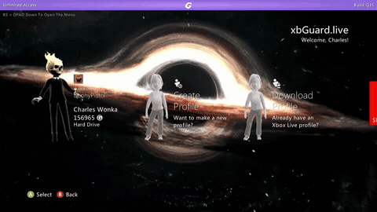

# WMVSlop

A video wallpaper for the Xbox 360 dashboard. WMVSlop is a DashLaunch plugin that plays a `.wmv` file on a
loop behind the stock dashboard's tiles, with its sound.



The same video with sound: [media/demo.mp4](media/demo.mp4)

- Plays one `.wmv` file, looping, behind the tiles on every dashboard page.
- Starts by itself when the console powers on.
- Streams the video from the USB stick or hard drive.
- Works over custom themes, and comes back by itself after a sign-in to Xbox Live.
- No per-version patches: it finds what it needs in the running dashboard.

> **Modified consoles only.** This needs a console that can run unsigned code (RGH, JTAG or Bad Update)
> with DashLaunch. It is a hobby project, it hooks the dashboard while it runs, and a video file the
> console's player can't handle can freeze the console. Use it at your own risk.

## What you need

- An Xbox 360 with RGH or JTAG and DashLaunch, or a console running the Bad Update exploit with the
  XeUnshackle payload (FreeMyXe can't load plugins, so it won't work there).
- Dashboard **2.0.16197 or newer**, up to 2.0.17559 (see [Supported dashboards](#supported-dashboards)).
- A FAT32 USB stick, or the console's hard drive.
- A video in WMV format.

## How to install

1. Download this repository (green **Code** button, **Download ZIP**) and unzip it.
2. Copy the folder `release/WMVSlop` to the root of your USB stick, so you have `USB:\WMVSlop\` with
   `WMVSlop.xex` and `WMVSlop.ini` in it. Keep both files.
3. Put **one** `.wmv` video in that same folder. If there are several, the first by name is played and the
   others are ignored.
4. Tell DashLaunch to load the plugin. Either set a plugin slot to `Usb:\WMVSlop\WMVSlop.xex` in
   DashLaunch's own menu and save, or add this under `[Plugins]` in `launch.ini` (use a free slot number):

   ```ini
   plugin1 = Usb:\WMVSlop\WMVSlop.xex
   ```

5. Turn the console **fully off and on**. A few seconds after the dashboard appears, the video starts.

For the hard drive, use `Hdd:\WMVSlop\` in both places. A USB stick is looked at first.

### Bad Update

1. Copy `release/WMVSlop` to the root of your Bad Update stick and add your video to it.
2. In the `launch.ini` that XeUnshackle provides, under `[Plugins]`, add
   `plugin1 = Usb:\WMVSlop\WMVSlop.xex`.
3. Run the exploit. When XeUnshackle finishes and you go to the dashboard, the video starts a few seconds
   later. A restart removes the exploit and the plugin with it.

### Updating

Replace `WMVSlop.xex` (and `WMVSlop.ini` if it changed), then turn the console fully off and on. A plugin
is loaded once at power-on; the old one stays in memory until then.

## How to make a video that plays well

The dashboard's own player does the decoding, in software, while the dashboard is running.

- **Format:** WMV video (WMV9 / "WMV3") with WMA audio, in a `.wmv` file.
- **Size:** 1280x720 at 30 fps is the best trade. The dashboard is drawn at 720p, so 1080p gains nothing
  and costs speed; 1080p at 60 fps will stutter.
- **Bitrate:** 4 to 6 Mbps is plenty.
- **Shape:** the picture is stretched to fill the screen, so you can use 720p videos and they will still show as 1080p videos its recommended.
- Try a new video on its own before relying on it. A file the player can't handle can freeze the console;
  pull the stick and restart if that happens.

## Settings

`WMVSlop.ini` sits beside the plugin and is read once at power-on. Keep the file in the folder even if
you never change it: streaming uses it. The settings most people would touch:

| Setting | Default | What it does |
|---|---|---|
| `video` | `1` | `0` turns the video off and only writes the log. |
| `stream` | `1` | `1` plays straight from the stick (any size). `0` loads the video into memory first, so it has to fit. |
| `auto` | `1` | Where the video sits. `1` over the dashboard's background, under the tiles. `3` behind everything with the dashboard's own background hidden (experimental; keeps playing through a sign-in). |
| `volume` | not set | Sound level in dB, `-96` (silent) to `6`. |
| `width`, `height` | `1280`, `720` | Size of the video on the dashboard's 1280x720 layout. |
| `delay` | `60` | Frames of dashboard to wait before adding the video. |
| `spread` | `0` | Experimental. Moves the player's work to another processor core. Stopped one console from connecting to Xbox Live; leave it off if you use Live. |

The file itself explains the rest.

## If something goes wrong

- **Pull the USB stick and restart.** With the plugin on the stick, nothing of it is left on the console.
- **No video:** check the plugin loaded (DashLaunch reports failures), that the `.wmv` is in the same
  folder as the plugin, and that the console was fully powered off and on.
- **Sound but no picture:** set `front=1` in the ini to check the video plays at all.
- **Stutter:** use a 1280x720, 30 fps file.
- `WMVSlop.log` in the folder records what the plugin did on the last start, with times, and
  `WMVSlop-previous.log` the start before that. Attach both when reporting a problem.
- Don't pull the stick while a video is playing; turn the console off first.

## Supported dashboards

Checked on the PC against the retail dashboard files of each version; run on real consoles on 17559 only.

| Dashboard (retail) | Works |
|---|---|
| 2.0.16197 to 2.0.17559 (late 2012 onward) | Yes: everything the plugin needs is there, streaming included |
| 2.0.14699 to 2.0.15574 (2011 to mid-2012) | No: these have no built-in video element |
| Kinect dashboard (2.0.12609 to 2.0.13604) | No |
| NXE (2.0.7357 to 2.0.9199) | No |
| Blades (2.0.1888 to 2.0.6770) | No |

Why the older ones don't work: WMVSlop doesn't decode video itself, it borrows the video element built
into the dashboard, and only the dashboards from 2.0.16197 on have one. This was checked in the NXE
dashboard file directly (build 9199): the names of its picture, text and shape elements are registered in
it, the video element's is not. The same goes for an old dashboard started as a program on a newer
console. On a dashboard it doesn't recognise the plugin does nothing and leaves it alone.

Aurora, Freestyle Dash and other replacement dashboards are different programs and are not supported.

## How it works

The stock dashboard already contains a video element (the `XuiVideo` class of its UI library) that plays
WMV through the dashboard's own player. WMVSlop creates one of those in the dashboard's element tree,
just above the background picture and below the tiles, and points it at your file.

- **Finding the dashboard's functions.** The dashboard has its own private copy of the UI library, with no
  names. `xam.xex` exports the same library by ordinal. At start-up the plugin compares the code of xam's
  exports with the dashboard's code and so finds the functions it needs, with no address table per
  dashboard version (`src/resolve.c`). If anything is missing it leaves the dashboard alone.
- **Running on the dashboard's thread.** The plugin redirects the dashboard's import thunk for the kernel's
  `VdSwap`, which the dashboard calls once per frame, and does its work there (`src/hook.S`,
  `wmvslop_tick` in `src/wmvslop.c`).
- **Streaming.** The video element only knows how to load a whole file into memory. The plugin gives it a
  small file to load instead and, when the element asks for a player, turns that request into one for a
  player that reads the real file from disk (`wmvslop_adjust_player`).
- **Staying there.** The dashboard rebuilds its background when someone signs in, taking the video with
  it. The plugin checks several times a second and puts the video back.

Comments in the source cite decompilation notes (`decomp/...`) and working notes that are not part of
this repository, because they are derived from the dashboard itself.

## Building

The plugin is built with [xsdk](https://github.com/xenosworks/xsdk), an open-source Xbox 360 toolchain
(GCC for PowerPC plus an import generator and a `.xex` packer). The Microsoft XDK is not needed.

1. Build xsdk's toolchain as its documentation describes.
2. Run the build with the paths to it:

   ```bash
   XSDK=/path/to/xsdk TC=/opt/xsdk-gcc/bin/powerpc-xsdk-elf- ./build.sh
   ```

   The result is `build/WMVSlop.xex`. `BASE=0x91D80000 ./build.sh` changes the address the plugin loads
   at, if it collides with another plugin.

`tools/mkxex.py` wraps xsdk's `elf2xex.py` to produce a system DLL: 4 KB pages, the image flags and PE
flag that system modules carry, and a load address below the dashboard. `tools/resolve_test.c` runs the
function matcher on the PC against unpacked `xam` and dashboard images.

## Credits

- [xsdk](https://github.com/xenosworks/xsdk) for the toolchain.
- [Xenia](https://github.com/xenia-project/xenia) for its tables of kernel and XAM export ordinals.
- [Xbox-360-Dashboard-Archive](https://github.com/thedev0ps/Xbox-360-Dashboard-Archive), used to check
  which dashboard versions have what the plugin needs.

## License

MIT. See [LICENSE](LICENSE). Xbox, Xbox 360 and Xbox Live are trademarks of Microsoft; this project is
not affiliated with or endorsed by Microsoft, and includes none of Microsoft's files.
